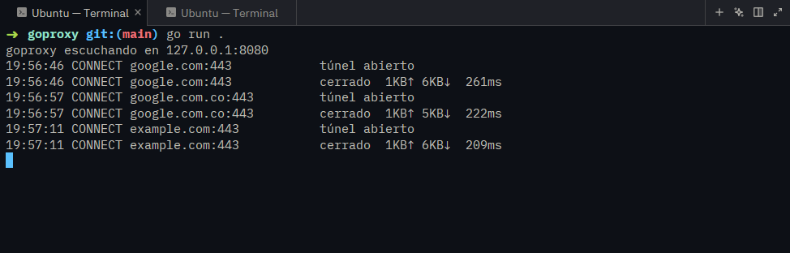
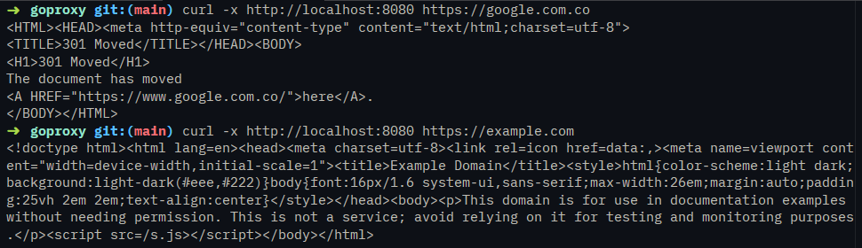
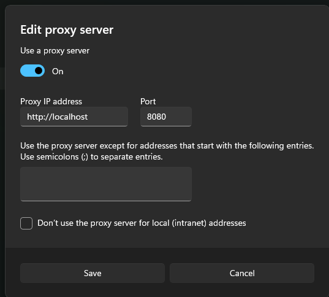
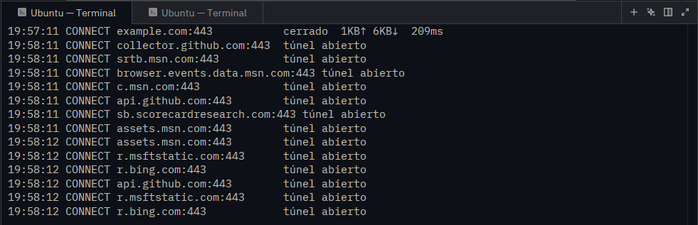
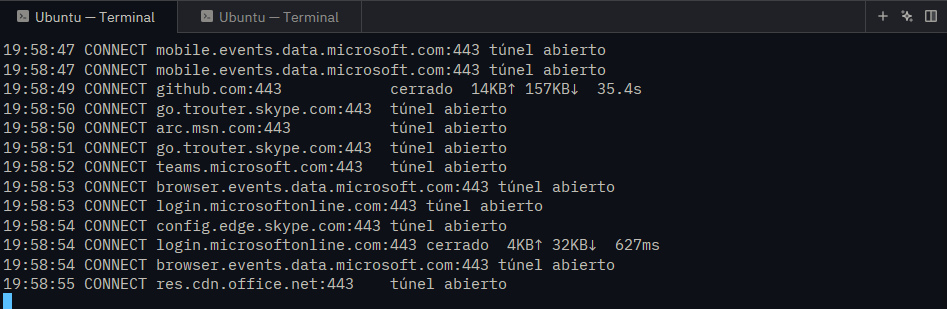
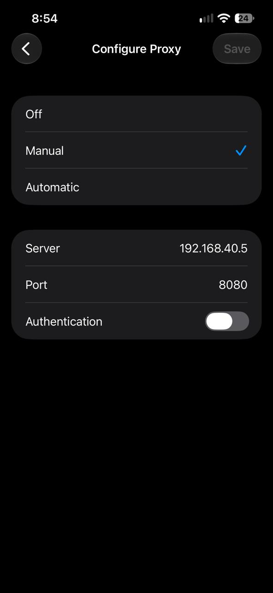
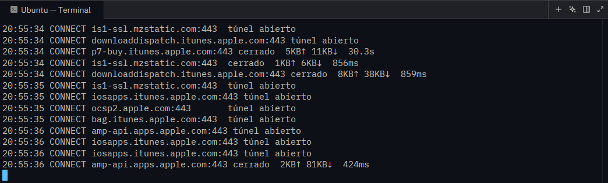
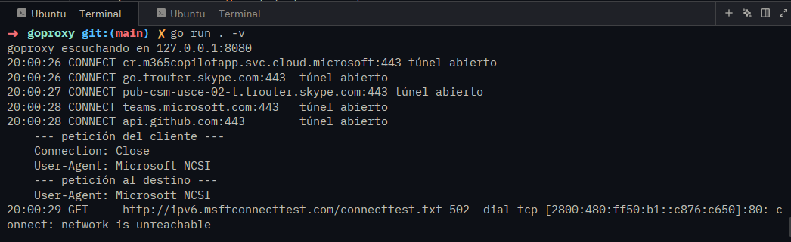
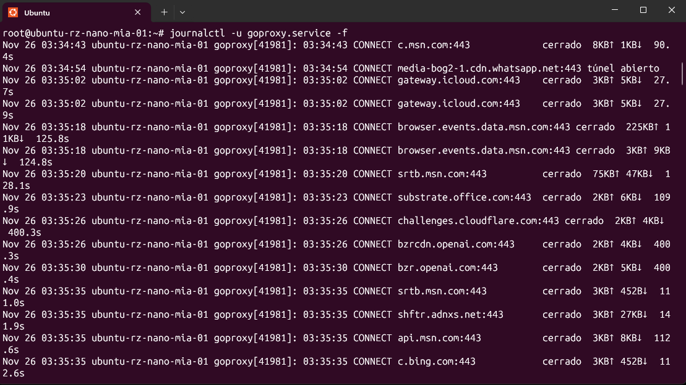

# goproxy

A forward HTTP proxy written from scratch in Go using only the standard
library. It forwards plain HTTP requests, tunnels HTTPS through `CONNECT`, and
logs each request and tunnel to the terminal while you browse.

It was built to learn how a proxy works on the inside, not to be a production
tool. The proxy works directly on TCP sockets from `net`. It uses `net/http`
only to parse and write HTTP messages, and never `http.Server`,
`http.Transport`, `http.Client` or `httputil`. Accepting connections,
rewriting requests, removing hop-by-hop headers, keep-alive and the
bidirectional tunnel are all written by hand.

## Quick start

You need Go 1.27.4 or newer. There are no external dependencies.

```sh
git clone https://github.com/yeferson59/goproxy.git
cd goproxy
go run .
```

```
goproxy escuchando en 127.0.0.1:8080
```

In a second terminal, send traffic through it:

```sh
curl -x http://127.0.0.1:8080 http://example.com/    # plain HTTP, forwarded
curl -x http://127.0.0.1:8080 https://example.com/   # HTTPS, tunneled
```

Press `Ctrl+C` to stop the proxy.

## Usage

```sh
go run . [-addr host:port] [-v]
# or build a binary (it is git-ignored)
go build -o goproxy . && ./goproxy -v
```

| Flag    | Default          | Description                                                                 |
|---------|------------------|-----------------------------------------------------------------------------|
| `-addr` | `127.0.0.1:8080` | Address the proxy listens on.                                               |
| `-v`    | off              | Print the full headers of every HTTP request and response, before and after hop-by-hop headers are removed. |

> [!WARNING]
> The proxy has no authentication. It listens on `127.0.0.1` by default so
> it can't be used as an open proxy by anyone on your network. Think twice
> before binding it to `0.0.0.0`. Authentication and a client allowlist are
> planned in [Phase 1 of the roadmap](ROADMAP.md#phase-1-safe-to-expose).

**Using it from a browser:** set the HTTP and HTTPS proxy to
`127.0.0.1:8080`. On Windows that's *Settings → Network & internet → Proxy →
Manual proxy setup* (see the [screenshot](evidences/proxy_config_windows.png));
Firefox has its own network settings. When running under WSL2, a Windows
browser can usually reach WSL's `localhost`. Remove the proxy setting when
you're done.

## Reading the log

The proxy prints one line per event: the time, the method, the target, and
then the result. Log messages are in Spanish. This is what they mean:

| Log text                                                    | Meaning                                                        |
|-------------------------------------------------------------|----------------------------------------------------------------|
| `goproxy escuchando en …`                                   | goproxy listening on …                                         |
| `GET http://example.com/  200  141ms`                       | Forwarded request: status code and total time                  |
| `CONNECT example.com:443  túnel abierto`                    | Tunnel opened                                                  |
| `CONNECT example.com:443  cerrado  1KB↑ 6KB↓  196ms`        | Tunnel closed: bytes client → target (↑), target → client (↓), duration |
| `GET http://nohay.invalid/  502  dial tcp: …`               | The proxy answered with an error itself (400, 502 or 504) and the reason |
| `ERROR …`                                                   | An error not tied to one request, such as a malformed request  |

With `-v`, each forwarded request also prints four header blocks:

| Block                       | Meaning                                    |
|-----------------------------|--------------------------------------------|
| `--- petición del cliente ---`  | Request as received from the client    |
| `--- petición al destino ---`   | Request as sent to the target server   |
| `--- respuesta del destino ---` | Response as received from the target   |
| `--- respuesta al cliente ---`  | Response as sent back to the client    |

## How it works

```
client ──TCP──▶ goproxy (127.0.0.1:8080)
                  │ reads one request (http.ReadRequest)
                  ├─ CONNECT ──▶ tunnel: dial host:port,
                  │              reply "200 Connection Established",
                  │              copy bytes in both directions
                  └─ other ────▶ forward: dial the target, send the rewritten
                                 request, read the response and write it
                                 back; if the connection stays alive, read
                                 the next request
```

**Connections.** Each client connection runs in its own goroutine, with one
`bufio.Reader` for the whole connection. Between requests the client has 60
seconds to send the next one before the proxy closes the connection.

**Plain HTTP forwarding**
- Only absolute `http://` URLs are accepted, which is how clients talk to a
  proxy. Anything else gets `400`.
- The request is rewritten from absolute form (`GET http://host/path`) to
  origin form (`GET /path`), which is how you talk to a server.
- Hop-by-hop headers (`Connection`, `Proxy-Connection`, `Keep-Alive`, `TE`,
  `Upgrade`, … and any header named in `Connection`) describe a single
  connection. They are removed in both directions.
- Each request opens a new connection to the target and asks it to close
  afterwards. Interim `1xx` responses (such as `100 Continue`) are skipped.
- The connection with the client stays open (keep-alive) unless the client
  asked to close it, or the response has no `Content-Length` and isn't
  chunked. In that case only closing the connection can mark the end of the
  body.

**HTTPS tunnels (`CONNECT`)**
- The proxy dials `host:port` and replies `200 Connection Established`.
  After that it copies raw bytes without looking at them, so the TLS session
  runs end to end between the client and the server.
- The upstream copy reads from the connection's `bufio.Reader`, not the raw
  socket. Otherwise, bytes the client sent right after the `CONNECT` line
  (the start of the TLS handshake) would be lost.
- When one direction finishes, only the write half of the other side is
  closed (`CloseWrite`), so the other direction can finish sending.

**Errors and timeouts**

| Situation                                                        | Response              |
|------------------------------------------------------------------|-----------------------|
| Malformed request, non-absolute URL, non-`http` scheme, `CONNECT` without a port | `400 Bad Request`     |
| Target unreachable (DNS failure, connection refused, no route)   | `502 Bad Gateway`     |
| Dialing the target took longer than 10 seconds                   | `504 Gateway Timeout` |

After any error response the proxy closes the client connection. Tunnels have
no idle limit, because a browser tab can keep one open for a long time.

## Evidence

### Manual testing

**HTTPS through curl.** The proxy is started with `go run .`, and three HTTPS
requests go through it as `CONNECT` tunnels: `google.com`, `google.com.co` and
`example.com`. Each tunnel logs when it opens and when it closes, with the
bytes sent each way and the duration.



**The curl side of the same requests.** Through the proxy,
`https://google.com.co` returns Google's `301 Moved` page and
`https://example.com` returns the Example Domain HTML.



**Windows proxy settings.** To send the browser's traffic through goproxy,
the Windows system proxy (*Settings → Network & internet → Proxy → Manual
proxy setup*) points at `localhost` on port `8080`, with no exceptions.



**A real browser.** With that setting on, the browser's traffic goes through
goproxy: dozens of tunnels to GitHub, MSN, Bing and Microsoft services. For example, `github.com:443` closed after
35.4 s with 14 KB up and 157 KB down.





**An iPhone on the same Wi-Fi.** The proxy ran under WSL2 with
`-addr 0.0.0.0:8080`, and the iPhone's Wi-Fi proxy (*Settings → Wi-Fi → (i)
→ Configure Proxy → Manual*) pointed at the PC's address on the local
network, `192.168.40.5`, port `8080`.



Reaching WSL2 from another device took three temporary changes on Windows,
all undone after the test. WSL2's default NAT networking forwards only
Windows' `localhost` to WSL, so a `netsh interface portproxy` rule forwarded
port 8080 on the Wi-Fi address to WSL. A Windows Firewall rule allowed the
port from the local subnet only. McAfee's firewall still blocked it, so it
was off during the test.

**Traffic from the phone.** The phone's requests arrive as `CONNECT` tunnels
to Apple hosts, mostly the App Store's (`*.itunes.apple.com`,
`amp-api.apps.apple.com`, `is1-ssl.mzstatic.com`), plus `ocsp2.apple.com`
for certificate checks. For example, `downloaddispatch.itunes.apple.com:443`
closed after 859 ms with 8 KB up and 38 KB down.



**Verbose mode and a 502.** The proxy runs with `-v` while Windows' network
connectivity check (`User-Agent: Microsoft NCSI`) sends a plain HTTP request
through it. The dump shows the headers received from the client and the
headers sent upstream: `Connection: Close` is a hop-by-hop header, so it is
removed. The target resolved only to an IPv6 address, and IPv6 isn't
available on that network, so the dial failed and the proxy answered
`502 Bad Gateway`.



**Plain HTTP, an unreachable host, and shutdown.** This transcript is from
running `curl` against the proxy and then stopping it with `SIGINT`:

```console
$ curl -x http://127.0.0.1:18080 http://example.com/    → 200, <title>Example Domain</title>
$ curl -x http://127.0.0.1:18080 https://example.com/   → 200, <title>Example Domain</title>
$ curl -x http://127.0.0.1:18080 http://nohay.invalid/  → 502
dial tcp: lookup nohay.invalid on 10.255.255.254:53: no such host
```

```
goproxy escuchando en 127.0.0.1:18080
20:07:11 GET     http://example.com/       200  141ms
20:07:11 CONNECT example.com:443           túnel abierto
20:07:12 GET     http://nohay.invalid/     502  dial tcp: lookup nohay.invalid on 10.255.255.254:53: no such host
20:07:12 CONNECT example.com:443           cerrado  1KB↑ 6KB↓  196ms
```

On `SIGINT` (`Ctrl+C`) the process exited with status 0 in 6 ms.

**Verbose mode for a plain HTTP request.** curl sends a `Proxy-Connection`
header to the proxy. On its own it sends `Proxy-Connection: Keep-Alive`; this
run set it explicitly with
`curl -x … -H 'Proxy-Connection: keep-alive' http://example.com/`. The header
is meant only for the proxy, so it appears in the client's request and not in
the request sent to the target:

```
    --- petición del cliente ---
    Accept: */*
    Proxy-Connection: keep-alive
    User-Agent: curl/8.18.0
    --- petición al destino ---
    Accept: */*
    User-Agent: curl/8.18.0
    --- respuesta del destino ---
    Accept-Ranges: bytes
    …
    Content-Type: text/html; charset=utf-8
    …
    Server: cloudflare
    --- respuesta al cliente ---
    Accept-Ranges: bytes
    …
    Content-Type: text/html; charset=utf-8
    …
    Server: cloudflare
20:07:12 GET     http://example.com/       200  123ms
```

(Response headers are trimmed where marked with `…`. The two response blocks
were otherwise identical, because the parsed response had no hop-by-hop
headers left to remove.)

### On a server

goproxy also ran on an Ubuntu 24.04 server as a systemd service,
`goproxy.service`, so it starts at boot and keeps running in the background
with no terminal open. Its output goes to the systemd journal, and
`journalctl -u goproxy.service -f` follows it live. `systemctl stop` sends
`SIGTERM`, which goproxy handles the same way as `Ctrl+C`.

Each journal line has two timestamps: journald's, followed by the host name
and `goproxy[41981]` (the process ID), and then goproxy's own. The tunnels go
to Microsoft services (`msn.com`, `bing.com`, `office.com`), iCloud,
WhatsApp's CDN, Cloudflare and OpenAI. For example,
`browser.events.data.msn.com:443` closed after 125.8 s with 225 KB up and
11 KB down. Lines longer than the terminal wrap onto the next line.



### Automated tests

```sh
go test -race ./...   # ok
go vet ./...          # no output
gofmt -l .            # no output
```

The tests run against local servers only (`httptest`, including a TLS
server for `CONNECT`), so they don't need internet access. They cover:

- **Forwarding:** `GET`, a `POST` with a large body, `chunked` responses,
  keep-alive across two requests, and hop-by-hop headers never reaching the
  target.
- **Errors:** unreachable target (`502`), dial timeout (`504`, through an
  injected dialer), and non-absolute URLs or non-`http` schemes (`400`).
- **Edge cases:** a response with neither `Content-Length` nor `chunked`,
  `Expect: 100-continue`, `HEAD` keeping the connection usable, a client
  sending `Connection: close`, and a slow body that outlives the idle
  timeout.
- **Tunnels:** HTTPS through `CONNECT`, bytes already buffered with the
  `CONNECT` line, echo in both directions, missing port (`400`), unreachable
  target (`502`), tunnels outliving the idle timeout, and the server closing
  first.
- **Connection handling:** concurrent clients, malformed requests (`400`),
  idle clients being closed, and clean shutdown when the listener closes.

## Project layout

| File          | Responsibility                                                          |
|---------------|-------------------------------------------------------------------------|
| `main.go`     | Flags, listener, `Ctrl+C` / `SIGTERM` shutdown                          |
| `proxy.go`    | `Proxy` type, timeouts, dialing the target, mapping dial errors to 502/504 |
| `conn.go`     | Accept loop, per-connection request loop, reading requests, error responses |
| `forward.go`  | Hop-by-hop header removal and plain HTTP forwarding                     |
| `tunnel.go`   | `CONNECT` tunnel and bidirectional copy                                 |
| `logging.go`  | Log line format                                                         |
| `*_test.go`   | Tests for each file, plus shared helpers in `helpers_test.go`           |

Reading HTTP requests goes through a single function (`readRequest`), so it
can later be replaced by a hand-written parser without touching the rest.

## Scope and roadmap

Not supported yet, with the roadmap phase that plans it:

- **Inspecting HTTPS content.** Tunnels are opaque. Reading HTTPS needs a
  local certificate authority and per-host certificates (MITM). *Phase 4.*
- Proxy authentication, a client allowlist, a destination policy for
  `CONNECT`, and limits on header size, upstream response time and concurrent
  connections. *Phase 1.*
- A configuration file, configurable timeouts, structured logs and graceful
  shutdown. *Phase 2.*
- Reusing connections to target servers, the `Via` header and WebSocket over
  `ws://`. *Phase 3.*
- SOCKS5, caching, filtering, chaining to another proxy and HTTP/2.
  *Phase 5.*

Out of scope: production-grade performance, HTTP/3, reverse proxy features,
and running as an open proxy.

[ROADMAP.md](ROADMAP.md) has the planned order, the gaps found in the
current code, and the principles every change keeps: standard library only,
nothing inside the proxy that hides the mechanism (`http.Server`,
`http.Transport`, `http.Client`, `httputil`), and listening on `127.0.0.1`
by default.
